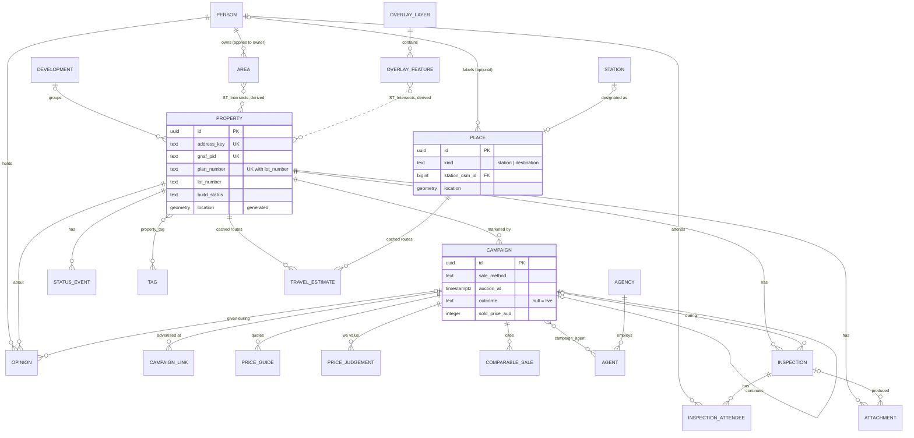

# House Track: plan for review

A self-hosted web app for a household tracking houses to buy: map, per-person opinions, campaign history, stations and places. Built first for one Melbourne household on Unraid, and designed so other households can run their own copy.

## 1. Decisions and assumptions

### Decisions (settled 2026-09-22)

| # | Topic | Decision | Effect on the design |
|---|---|---|---|
| D1 | Opinion scope | Opinions belong to the **property**, with the campaign they were given under recorded as context. | `opinion.campaign_id` is optional. A relist shows "no during campaign 1, now listed lower". |
| D2 | Price figures | **Joint only.** | `price_judgement` has no `person_id`. `created_by` records who entered each revision. |
| D3 | Drawn areas | **Each area belongs to one person and applies only to them. Everyone sees every area.** | `area.owner_id`. Flags are per person: your hard exclude greys a property out for you. Your partner sees a "flagged by A" badge and your outline, and the property is not hidden for them. Imported overlays apply to everyone. |
| D4 | Property kinds | Mostly established homes, but the model handles **off-the-plan and units**. | Plan + lot is a second natural key. A street number is optional when plan + lot is present. `build_status` and the `development` table exist. |
| D5 | Remote access | **Tailscale only**, at home and away. | A Tailscale sidecar container provides HTTPS on `house.<tailnet>.ts.net`. No domain, no DNS challenge, no LAN port. Anyone deploying the app needs Tailscale. |
| D6 | Offline scope | **Small.** Recently viewed properties stay readable offline, and opinions and notes queue until the connection returns. | Photos and bid logs need a connection. Phone-generated UUIDs stay in the model. |
| D7 | Outside services | **Free services only.** | Self-hosted routing, public Nominatim as the geocoding fallback, a free aerial layer. No paid APIs. |
| D8 | Distribution | **Each household runs its own copy.** MIT licence, images on GitHub's container registry, repo private until milestone 2. | Single household per install, no accounts. Paths, hostname, region and time zone all come from `.env`. |
| D9 | Region | **Victoria first**, with state-specific parts in a replaceable **region pack**. | The database stores generic values (`price_statement`, `vendor_statement`, `strata_certificate`). The pack supplies local labels ("Statement of Information", "Section 32"), validation (plan-number formats) and data importers. |
| D10 | Stations and places | **Stations** are picked only from a list of OpenStreetMap stations imported for the region, and show walking distance and time. **Destinations** (work, family, childcare) show walking and driving distance and time. Places are shared, with an optional person label. | New tables `station`, `place`, `travel_estimate`. Each property shows its nearest station plus any others within a household walking limit (default 20 minutes). |
| D11 | Routing | **Self-hosted Valhalla** built from the region's OpenStreetMap extract. Driving times are labelled "no traffic". | Results are stored in `travel_estimate` and refreshed by a background job. This is the one stored exception to "derive on read". |
| D12 | Listing import | A **bookmarklet or iOS share-sheet action**, plus a best-effort server fetch when a URL is pasted. Both only pre-fill the form. | ⚠ Both depend on scraping and are fragile. The manual form is always the main path. |
| D13 | Verdicts and status | No blind verdicts. **Pipeline status is one shared value per property.** | UI only. |
| D14 | Data entry and backups | No spreadsheet import; quick-add is the entry path. **Nightly offsite backup copy over Tailscale.** | An `offsite` ops service using rclone. |
| D15 | Desktop overview (settled 2026-09-22) | An **Overview** tab: an Excel-like grid with **one row per house** (its live or latest campaign), per-column filters, multi-column sort, range copy/paste, fill down, single-step undo, CSV export. Cells **save when you leave them**. Built on **RevoGrid** (MIT), subject to a half-day spike; the fallback is react-data-grid. Hidden from the phone navigation. | Read model: one flattened `/api/overview` row per house. No new property columns. |
| D16 | Editing in the grid | The address is **read-only** in the grid. History fields (status, verdicts, price guides, joint figures) **append** an entry. Anyone can edit anyone's verdict cells; `created_by` records who typed it. Guide edits default to source "advertised". Derived columns are read-only. A blank last row adds a house, with the normal duplicate check. Undo writes the previous value back (history fields append it). | None beyond D17. |
| D17 | Conflicts | **Per-field compare-and-set on every write API.** A write may carry the value it saw ("expected"): the plain value for ordinary fields, the latest entry's ID for history fields. The server checks it inside the transaction and returns 409 with the current value, who changed it and when. The UI offers **Keep mine / Keep theirs**, plus **Keep both** for history fields. Writes without "expected" stay last-write-wins. | No schema change: `updated_by`/`updated_at` and the append-only tables already hold what the 409 reports. The milestone-3 offline queue uses this. |
| D18 | Saved views | **Shared** named views (filters, sort, visible columns) stored in the database, used by both Overview and the phone Houses tab. The default view hides rejected, lost, withdrawn and bought, and can be edited. Column widths and order are remembered per device. | New `grid_view` table. |
| D19 | Favourite places | Up to **five shared favourite places**. They get default drive-time columns in Overview and appear on phone cards. | New `place.is_favourite`; the five-favourite limit is enforced by a trigger. |

### Assumptions (⚠ = expensive to reverse later)

| # | Assumption | Reversal cost |
|---|---|---|
| A1 | **Property identity** is a surrogate UUID. Matching uses three natural keys in priority order: the G-NAF address ID, then plan + lot, then a normalised address key. A strata unit is its own property. An off-the-plan lot keeps the same row when it later gets a street address and a G-NAF ID. | ⚠ High. Every other table hangs off it. |
| A2 | **Campaign** means one marketing effort. The same ad on two portals is one campaign with two links. Remarketing after a withdrawal or a quiet pass-in is a new campaign linked to the old one. Selling in negotiation right after a pass-in stays within the same campaign. | ⚠ High |
| A3 | **Primary keys are UUIDv7 that the phone can generate**, so queued offline writes replay safely without creating duplicates. | ⚠ High |
| A4 | Opinions, price guides, price judgements and status changes are **append-only**. The current value is always the latest row. | ⚠ Medium |
| A5 | The region pack covers **Australian states only** (G-NAF is national). Money is stored as **whole AUD in `integer`** columns with an `_aud` suffix, with no currency column. | Medium if the app ever leaves Australia; otherwise low. |
| A6 | "Reserve price range" in the original brief means the agent's **indicative range on the price statement** (the SOI in Victoria). Our estimate of the real reserve is a separate figure. | Low |
| A7 | Pre-inspection interest and the post-inspection verdict ("pursue to buy?") both use yes / maybe / no. | Low |
| A8 | Scale per household: under 1,000 properties, under 50 areas, under 50 places, 10–30 GB of photos. The time zone comes from `.env`; all timestamps are `timestamptz`. | Low |
| A9 | The routing engine and basemap cover a **search-area bounding box**, not a whole state. Houses outside the box can be tracked but get no travel times until the box is widened and setup is re-run. | Low |

## 2. Domain model

**Property, development, campaign and sale outcome.**
- A **property** is the physical dwelling, or for off-the-plan a lot that doesn't exist yet. Its identity is a surrogate UUID. Matching uses three natural keys, in this order:
  1. The G-NAF `ADDRESS_DETAIL_PID`. G-NAF is the authoritative national address file, lists units as separate addresses, and its IDs are stable across releases.
  2. **Plan + lot** (e.g. `PS812345` / `23`). This identifies an off-the-plan lot before it has a street number, and appears in every vendor statement for established homes too. The region pack validates the format, because it varies by state.
  3. `address_key`, a normalised string ("3/12 smith st" becomes "3 12 smith street …"; "Lot 23 Smith Rd" becomes "lot 23 smith road …"). One normaliser in the API produces it for every entry path. It can change when an off-the-plan lot gets its real address, which is why the UUID is the identity.

  Portal listing IDs are never a property key: they identify adverts, change on relisting, and differ between portals.
- A **development** optionally groups properties that share a building or an estate: units in one block, or lots in one release.
- A **campaign** is one marketing effort, with any number of **campaign links** (portal adverts). A partial unique index allows only one live campaign per property. When an import arrives for a property that already has a live campaign, the UI asks whether it's the same ad cross-posted or a relist.
- The **sale outcome** is a set of nullable columns on the campaign. There's at most one per campaign and it has no lifecycle of its own, and keeping it on the campaign lets the "one live campaign" index work.

**Money.** All figures are joint (D2).

| Figure | Shape | Versioned? | Table |
|---|---|---|---|
| Agent's indicative price (price statement, advert, verbal) | Range; `low = high` for a single figure | Yes, one row per observation | `price_guide` |
| Our estimated reserve / expected sale | Point | Yes | `price_judgement` |
| Walk-away maximum | Point | Yes; the latest row is the auction-day limit | `price_judgement` |
| Sold price / passed-in bid | Point, nullable if undisclosed | No. It's a fact, and corrections are audited | `campaign` |
| Comparable sale price | Point | No | `comparable_sale` |

Ranges are two columns plus a CHECK rather than `int8range`. They're easier to handle in drivers and JSON, and there's no confusion about whether bounds are inclusive.

**Opinions** are append-only rows keyed by `(property, person, stage)`, and history is kept ("maybe → no after the guide rose"). A third person is a new `person` row, not a migration.

**Pipeline status** is an append-only `status_event` log, shared by the household, with the current value coming from a view. It isn't derived from other events, because "shortlisted", "bidding" and "rejected" are decisions, not facts. It isn't a plain column, because that loses history. The API suggests changes when facts arrive (a campaign sold to someone else suggests "lost"), and a person confirms them.

**Areas belong to one person and are visible to everyone** (D3). `property_flags` is computed per person from that person's own areas plus household-wide overlays. `property_area_hit` lists every hit with its owner, and drives the "flagged by" badges.

**Flags are computed on read, not stored.** ST_Intersects at this scale takes microseconds. A stored flag would need updating whenever a pin moved or an area changed.

**Stations and places** (D10, D11). The setup job fills `station` from the region's OpenStreetMap extract, and nobody edits it. Designating a station creates a `place` row that points to it. Destinations are `place` rows with a pin and an optional person label. Walking and driving figures come from the routing engine, not PostGIS, so they're stored in `travel_estimate`. Each row keeps the origin and destination points it was calculated from. The `travel_estimate_stale` view compares those points with the current ones and acts as the background job's work queue, so a moved pin or a new place is recalculated without triggers.



```sql
-- PostgreSQL 18 + PostGIS 3.6
CREATE EXTENSION IF NOT EXISTS postgis;
CREATE EXTENSION IF NOT EXISTS pg_trgm;

-- ─── identity & attribution ───────────────────────────────────────────
CREATE TABLE person (
  id           uuid PRIMARY KEY DEFAULT uuidv7(),
  display_name text NOT NULL UNIQUE,
  colour       text NOT NULL CHECK (colour ~ '^#[0-9a-f]{6}$'),
  active       boolean NOT NULL DEFAULT true,
  created_at   timestamptz NOT NULL DEFAULT now()
);

-- The API runs SET LOCAL app.person_id = '<uuid>' at the start of every write transaction.
CREATE FUNCTION app_person() RETURNS uuid LANGUAGE sql STABLE
AS $$ SELECT nullif(current_setting('app.person_id', true), '')::uuid $$;

CREATE FUNCTION touch() RETURNS trigger LANGUAGE plpgsql AS $$
BEGIN
  NEW.updated_at := now();
  NEW.updated_by := app_person();      -- NOT NULL column rejects unattributed writes
  RETURN NEW;
END $$;

CREATE FUNCTION append_only() RETURNS trigger LANGUAGE plpgsql AS $$
BEGIN
  RAISE EXCEPTION '% is append-only; insert a new row', TG_TABLE_NAME;
END $$;

CREATE TABLE audit_log (
  id         bigint GENERATED ALWAYS AS IDENTITY PRIMARY KEY,
  at         timestamptz NOT NULL DEFAULT now(),
  person_id  uuid REFERENCES person,
  table_name text NOT NULL,
  row_id     text,
  op         char(1) NOT NULL CHECK (op IN ('I','U','D')),
  old_row    jsonb,
  new_row    jsonb
);
CREATE INDEX audit_log_row_idx ON audit_log (table_name, row_id, at);

CREATE FUNCTION audit_row() RETURNS trigger LANGUAGE plpgsql AS $$
DECLARE o jsonb; n jsonb; r jsonb;
BEGIN
  IF TG_OP <> 'INSERT' THEN o := to_jsonb(OLD); END IF;
  IF TG_OP <> 'DELETE' THEN n := to_jsonb(NEW); END IF;
  r := coalesce(n, o);
  INSERT INTO audit_log (person_id, table_name, row_id, op, old_row, new_row)
  VALUES (app_person(), TG_TABLE_NAME, coalesce(r ->> 'id', r ->> 'key'), left(TG_OP, 1), o, n);
  RETURN NULL;
END $$;

CREATE TABLE household_setting (
  key        text PRIMARY KEY CHECK (key ~ '^[a-z][a-z0-9_]*$'),   -- e.g. 'walk_limit_min'
  value      jsonb NOT NULL,
  updated_at timestamptz NOT NULL DEFAULT now(),
  updated_by uuid NOT NULL DEFAULT app_person() REFERENCES person
);

-- ─── development (building or estate) ─────────────────────────────────
CREATE TABLE development (
  id                  uuid PRIMARY KEY DEFAULT uuidv7(),
  name                text NOT NULL,
  kind                text NOT NULL CHECK (kind IN ('apartment_building','townhouse_complex','estate')),
  developer           text,
  plan_number         text,
  expected_completion date,
  location            geometry(Point, 4326),
  footprint           geometry(MultiPolygon, 4326) CHECK (footprint IS NULL OR ST_IsValid(footprint)),
  notes               text,
  created_at timestamptz NOT NULL DEFAULT now(), created_by uuid NOT NULL DEFAULT app_person() REFERENCES person,
  updated_at timestamptz NOT NULL DEFAULT now(), updated_by uuid NOT NULL DEFAULT app_person() REFERENCES person
);
CREATE INDEX development_footprint_gix ON development USING gist (footprint);

-- ─── property ─────────────────────────────────────────────────────────
CREATE TABLE property (
  id                 uuid PRIMARY KEY DEFAULT uuidv7(),
  address_key        text NOT NULL UNIQUE,
  gnaf_pid           text UNIQUE,
  plan_number        text,                -- format validated by the region pack
  lot_number         text,
  development_id     uuid REFERENCES development ON DELETE SET NULL,
  build_status       text NOT NULL DEFAULT 'established'
                     CHECK (build_status IN ('established','off_the_plan','under_construction')),
  unit               text,
  street_number      text,
  street             text,
  suburb             text NOT NULL,
  postcode           char(4) NOT NULL CHECK (postcode ~ '^[0-9]{4}$'),
  property_type      text NOT NULL DEFAULT 'house'
                     CHECK (property_type IN ('house','townhouse','unit','apartment','land','other')),
  beds               smallint CHECK (beds BETWEEN 0 AND 20),
  baths              smallint CHECK (baths BETWEEN 0 AND 20),
  car_spaces         smallint CHECK (car_spaces BETWEEN 0 AND 20),
  land_m2            integer  CHECK (land_m2 > 0),
  building_m2        integer  CHECK (building_m2 > 0),
  geocoded_location  geometry(Point, 4326),
  geocode_source     text CHECK (geocode_source IN ('gnaf','nominatim','listing')),
  geocode_confidence real CHECK (geocode_confidence BETWEEN 0 AND 1),
  geocode_detail     jsonb,
  manual_location    geometry(Point, 4326),
  manual_location_by uuid REFERENCES person,
  location           geometry(Point, 4326)
                     GENERATED ALWAYS AS (coalesce(manual_location, geocoded_location)) STORED,
  owners_corp_fees_aud_pa integer CHECK (owners_corp_fees_aud_pa >= 0),
  council_rates_aud_pa    integer CHECK (council_rates_aud_pa >= 0),
  notes              text,
  created_at timestamptz NOT NULL DEFAULT now(), created_by uuid NOT NULL DEFAULT app_person() REFERENCES person,
  updated_at timestamptz NOT NULL DEFAULT now(), updated_by uuid NOT NULL DEFAULT app_person() REFERENCES person,
  UNIQUE (plan_number, lot_number),
  CHECK ((plan_number IS NULL) = (lot_number IS NULL)),
  CHECK ((street_number IS NOT NULL AND street IS NOT NULL) OR plan_number IS NOT NULL),
  CHECK ((manual_location IS NULL) = (manual_location_by IS NULL)),
  CHECK ((geocoded_location IS NULL) = (geocode_source IS NULL))
);
CREATE INDEX property_location_gix    ON property USING gist (location);
CREATE INDEX property_address_trgm    ON property USING gin (address_key gin_trgm_ops);
CREATE INDEX property_development_idx ON property (development_id);

-- ─── agents ───────────────────────────────────────────────────────────
CREATE TABLE agency (
  id      uuid PRIMARY KEY DEFAULT uuidv7(),
  name    text NOT NULL,
  office  text,
  phone   text,
  website text,
  created_at timestamptz NOT NULL DEFAULT now(), created_by uuid NOT NULL DEFAULT app_person() REFERENCES person,
  updated_at timestamptz NOT NULL DEFAULT now(), updated_by uuid NOT NULL DEFAULT app_person() REFERENCES person,
  UNIQUE NULLS NOT DISTINCT (name, office)
);

CREATE TABLE agent (
  id        uuid PRIMARY KEY DEFAULT uuidv7(),
  agency_id uuid REFERENCES agency ON DELETE SET NULL,
  name      text NOT NULL,
  mobile    text,
  email     text,
  notes     text,
  created_at timestamptz NOT NULL DEFAULT now(), created_by uuid NOT NULL DEFAULT app_person() REFERENCES person,
  updated_at timestamptz NOT NULL DEFAULT now(), updated_by uuid NOT NULL DEFAULT app_person() REFERENCES person
);

-- ─── campaign (listing) + outcome ─────────────────────────────────────
CREATE TABLE campaign (
  id                    uuid PRIMARY KEY DEFAULT uuidv7(),
  property_id           uuid NOT NULL REFERENCES property ON DELETE CASCADE,
  continues_campaign_id uuid REFERENCES campaign ON DELETE SET NULL,
  sale_method           text NOT NULL CHECK (sale_method IN ('auction','eoi','private_sale','other')),
  listed_on             date,
  auction_at            timestamptz,
  eoi_closes_at         timestamptz,
  outcome               text CHECK (outcome IN ('sold_prior','sold_at_auction','sold_after_auction','sold',
                                                'passed_in','withdrawn','disappeared')),
  outcome_on            date,
  sold_price_aud        integer CHECK (sold_price_aud > 0),
  passed_in_bid_aud     integer CHECK (passed_in_bid_aud > 0),
  bought_by_us          boolean NOT NULL DEFAULT false,
  created_at timestamptz NOT NULL DEFAULT now(), created_by uuid NOT NULL DEFAULT app_person() REFERENCES person,
  updated_at timestamptz NOT NULL DEFAULT now(), updated_by uuid NOT NULL DEFAULT app_person() REFERENCES person,
  UNIQUE (id, property_id),
  CHECK (auction_at IS NULL OR sale_method = 'auction'),
  CHECK (eoi_closes_at IS NULL OR sale_method = 'eoi'),
  CHECK ((outcome IS NULL) = (outcome_on IS NULL)),
  CHECK (sold_price_aud IS NULL OR outcome LIKE 'sold%'),
  CHECK (passed_in_bid_aud IS NULL OR sale_method = 'auction'),
  CHECK (NOT bought_by_us OR outcome LIKE 'sold%')
);
CREATE UNIQUE INDEX campaign_one_live_per_property ON campaign (property_id) WHERE outcome IS NULL;
CREATE INDEX campaign_auction_at_idx ON campaign (auction_at) WHERE auction_at IS NOT NULL;

CREATE TABLE campaign_agent (
  campaign_id uuid REFERENCES campaign ON DELETE CASCADE,
  agent_id    uuid REFERENCES agent ON DELETE RESTRICT,
  is_lead     boolean NOT NULL DEFAULT false,
  PRIMARY KEY (campaign_id, agent_id)
);
CREATE UNIQUE INDEX campaign_one_lead_agent ON campaign_agent (campaign_id) WHERE is_lead;

CREATE TABLE campaign_link (
  id              uuid PRIMARY KEY DEFAULT uuidv7(),
  campaign_id     uuid NOT NULL REFERENCES campaign ON DELETE CASCADE,
  portal          text NOT NULL CHECK (portal IN ('domain','rea','agency','other')),
  url             text NOT NULL UNIQUE,
  external_id     text,
  last_checked_at timestamptz,
  created_at timestamptz NOT NULL DEFAULT now(), created_by uuid NOT NULL DEFAULT app_person() REFERENCES person,
  UNIQUE (portal, external_id)
);

-- ─── money (append-only) ──────────────────────────────────────────────
CREATE TABLE price_guide (
  id                          uuid PRIMARY KEY DEFAULT uuidv7(),
  campaign_id                 uuid NOT NULL REFERENCES campaign ON DELETE CASCADE,
  source                      text NOT NULL CHECK (source IN ('price_statement','advertised','agent_verbal','other')),
  low_aud                     integer NOT NULL CHECK (low_aud > 0),
  high_aud                    integer NOT NULL,
  statement_suburb_median_aud integer CHECK (statement_suburb_median_aud > 0),
  observed_at                 timestamptz NOT NULL DEFAULT now(),
  note                        text,
  created_at timestamptz NOT NULL DEFAULT now(), created_by uuid NOT NULL DEFAULT app_person() REFERENCES person,
  CHECK (high_aud >= low_aud)
);
CREATE INDEX price_guide_campaign_idx ON price_guide (campaign_id, observed_at);

CREATE TABLE price_judgement (
  id          uuid PRIMARY KEY DEFAULT uuidv7(),
  campaign_id uuid NOT NULL REFERENCES campaign ON DELETE CASCADE,
  kind        text NOT NULL CHECK (kind IN ('estimated_reserve','expected_sale','walk_away')),
  amount_aud  integer NOT NULL CHECK (amount_aud > 0),   -- always the joint figure
  note        text,
  created_at timestamptz NOT NULL DEFAULT now(), created_by uuid NOT NULL DEFAULT app_person() REFERENCES person
);
CREATE INDEX price_judgement_current_idx ON price_judgement (campaign_id, kind, created_at DESC);

-- ─── opinions & status (append-only) ──────────────────────────────────
CREATE TABLE opinion (
  id          uuid PRIMARY KEY DEFAULT uuidv7(),   -- normally client-generated
  property_id uuid NOT NULL REFERENCES property ON DELETE CASCADE,
  campaign_id uuid,
  person_id   uuid NOT NULL REFERENCES person,
  stage       text NOT NULL CHECK (stage IN ('pre_inspection','post_inspection')),
  stance      text NOT NULL CHECK (stance IN ('yes','maybe','no')),
  note        text,
  recorded_at timestamptz NOT NULL,
  created_at timestamptz NOT NULL DEFAULT now(), created_by uuid NOT NULL DEFAULT app_person() REFERENCES person,
  FOREIGN KEY (campaign_id, property_id) REFERENCES campaign (id, property_id) ON DELETE SET NULL (campaign_id)
);
CREATE INDEX opinion_current_idx ON opinion (property_id, person_id, stage, recorded_at DESC);

CREATE TABLE status_event (
  id          uuid PRIMARY KEY DEFAULT uuidv7(),
  property_id uuid NOT NULL REFERENCES property ON DELETE CASCADE,
  status      text NOT NULL CHECK (status IN ('watching','inspecting','shortlisted','bidding',
                                              'rejected','lost','withdrawn','bought')),
  reason      text,
  occurred_at timestamptz NOT NULL DEFAULT now(),
  created_at timestamptz NOT NULL DEFAULT now(), created_by uuid NOT NULL DEFAULT app_person() REFERENCES person
);
CREATE INDEX status_event_property_idx ON status_event (property_id, occurred_at DESC);

-- ─── inspections ──────────────────────────────────────────────────────
CREATE TABLE inspection (
  id          uuid PRIMARY KEY DEFAULT uuidv7(),
  property_id uuid NOT NULL REFERENCES property ON DELETE CASCADE,
  campaign_id uuid,
  kind        text NOT NULL CHECK (kind IN ('open','private','second_look','building_pest',
                                            'display_suite','pre_settlement','other')),
  starts_at   timestamptz NOT NULL,
  ends_at     timestamptz,
  state       text NOT NULL DEFAULT 'planned' CHECK (state IN ('planned','attended','skipped','cancelled')),
  inspector   text,
  notes       text,
  created_at timestamptz NOT NULL DEFAULT now(), created_by uuid NOT NULL DEFAULT app_person() REFERENCES person,
  updated_at timestamptz NOT NULL DEFAULT now(), updated_by uuid NOT NULL DEFAULT app_person() REFERENCES person,
  CHECK (ends_at IS NULL OR ends_at > starts_at),
  FOREIGN KEY (campaign_id, property_id) REFERENCES campaign (id, property_id) ON DELETE SET NULL (campaign_id)
);
CREATE INDEX inspection_starts_idx   ON inspection (starts_at);
CREATE INDEX inspection_property_idx ON inspection (property_id);

CREATE TABLE inspection_attendee (
  inspection_id uuid REFERENCES inspection ON DELETE CASCADE,
  person_id     uuid REFERENCES person,
  note          text,
  PRIMARY KEY (inspection_id, person_id)
);

-- ─── areas & overlays ─────────────────────────────────────────────────
CREATE TABLE area (
  id          uuid PRIMARY KEY DEFAULT uuidv7(),
  owner_id    uuid NOT NULL DEFAULT app_person() REFERENCES person,   -- the area applies to this person only
  name        text NOT NULL,
  kind        text NOT NULL CHECK (kind IN ('hard_exclude','soft_warn')),
  reason      text,
  geom        geometry(MultiPolygon, 4326) NOT NULL CHECK (ST_IsValid(geom) AND NOT ST_IsEmpty(geom)),
  archived_at timestamptz,
  created_at timestamptz NOT NULL DEFAULT now(), created_by uuid NOT NULL DEFAULT app_person() REFERENCES person,
  updated_at timestamptz NOT NULL DEFAULT now(), updated_by uuid NOT NULL DEFAULT app_person() REFERENCES person
);
CREATE INDEX area_geom_gix  ON area USING gist (geom);
CREATE INDEX area_owner_idx ON area (owner_id);

CREATE TABLE overlay_layer (
  id          uuid PRIMARY KEY DEFAULT uuidv7(),
  code        text NOT NULL UNIQUE,
  title       text NOT NULL,
  effect      text NOT NULL DEFAULT 'info' CHECK (effect IN ('info','soft_warn','hard_exclude')),
  source_url  text,
  licence     text,
  data_as_of  date,
  imported_at timestamptz NOT NULL DEFAULT now()
);

CREATE TABLE overlay_feature (
  id       bigint GENERATED ALWAYS AS IDENTITY PRIMARY KEY,
  layer_id uuid NOT NULL REFERENCES overlay_layer ON DELETE CASCADE,
  label    text,
  attrs    jsonb NOT NULL DEFAULT '{}',
  geom     geometry(MultiPolygon, 4326) NOT NULL
);
CREATE INDEX overlay_feature_geom_gix  ON overlay_feature USING gist (geom);
CREATE INDEX overlay_feature_layer_idx ON overlay_feature (layer_id);

-- ─── stations, places, travel ─────────────────────────────────────────
-- Filled by the setup job from the region's OpenStreetMap extract. Setup upserts; it never deletes a
-- station a place still points to.
CREATE TABLE station (
  osm_id       bigint PRIMARY KEY,
  name         text NOT NULL,
  location     geometry(Point, 4326) NOT NULL,
  refreshed_at timestamptz NOT NULL DEFAULT now()
);
CREATE INDEX station_location_gix ON station USING gist (location);
CREATE INDEX station_name_trgm    ON station USING gin (name gin_trgm_ops);

CREATE TABLE place (
  id             uuid PRIMARY KEY DEFAULT uuidv7(),
  kind           text NOT NULL CHECK (kind IN ('station','destination')),
  name           text NOT NULL,
  station_osm_id bigint UNIQUE REFERENCES station ON DELETE RESTRICT,
  person_id      uuid REFERENCES person,     -- optional label ("A's work"); everyone still sees it
  location       geometry(Point, 4326) NOT NULL,
  archived_at    timestamptz,
  created_at timestamptz NOT NULL DEFAULT now(), created_by uuid NOT NULL DEFAULT app_person() REFERENCES person,
  updated_at timestamptz NOT NULL DEFAULT now(), updated_by uuid NOT NULL DEFAULT app_person() REFERENCES person,
  CHECK ((kind = 'station') = (station_osm_id IS NOT NULL))
);
CREATE INDEX place_location_gix ON place USING gist (location);

-- System-maintained cache of routing-engine results; not audited.
CREATE TABLE travel_estimate (
  property_id uuid NOT NULL REFERENCES property ON DELETE CASCADE,
  place_id    uuid NOT NULL REFERENCES place ON DELETE CASCADE,
  mode        text NOT NULL CHECK (mode IN ('walk','drive')),
  origin      geometry(Point, 4326) NOT NULL,   -- property.location this route was computed from
  destination geometry(Point, 4326) NOT NULL,   -- place.location this route was computed to
  distance_m  integer CHECK (distance_m >= 0),
  duration_s  integer CHECK (duration_s >= 0),  -- NULL = no route found
  engine      text NOT NULL,
  computed_at timestamptz NOT NULL DEFAULT now(),
  PRIMARY KEY (property_id, place_id, mode),
  CHECK ((distance_m IS NULL) = (duration_s IS NULL))
);
CREATE INDEX travel_estimate_place_idx ON travel_estimate (place_id);

-- ─── tags, attachments, comparables ───────────────────────────────────
CREATE TABLE tag (
  id     uuid PRIMARY KEY DEFAULT uuidv7(),
  name   text NOT NULL,
  colour text CHECK (colour ~ '^#[0-9a-f]{6}$'),
  created_at timestamptz NOT NULL DEFAULT now(), created_by uuid NOT NULL DEFAULT app_person() REFERENCES person
);
CREATE UNIQUE INDEX tag_name_uq ON tag (lower(name));

CREATE TABLE property_tag (
  property_id uuid REFERENCES property ON DELETE CASCADE,
  tag_id      uuid REFERENCES tag ON DELETE CASCADE,
  created_at timestamptz NOT NULL DEFAULT now(), created_by uuid NOT NULL DEFAULT app_person() REFERENCES person,
  PRIMARY KEY (property_id, tag_id)
);
CREATE INDEX property_tag_tag_idx ON property_tag (tag_id);

CREATE TABLE attachment (
  id             uuid PRIMARY KEY DEFAULT uuidv7(),
  property_id    uuid NOT NULL REFERENCES property ON DELETE CASCADE,
  campaign_id    uuid,
  inspection_id  uuid REFERENCES inspection ON DELETE SET NULL,
  kind           text NOT NULL CHECK (kind IN ('photo','floorplan','price_statement','vendor_statement','contract',
                                               'building_report','pest_report','strata_report',
                                               'strata_certificate','plans_specs','other')),
  sha256         char(64) CHECK (sha256 ~ '^[0-9a-f]{64}$'),
  mime_type      text,
  byte_size      bigint CHECK (byte_size >= 0),
  original_name  text,
  url            text,
  caption        text,
  taken_at       timestamptz,
  taken_location geometry(Point, 4326),
  created_at timestamptz NOT NULL DEFAULT now(), created_by uuid NOT NULL DEFAULT app_person() REFERENCES person,
  updated_at timestamptz NOT NULL DEFAULT now(), updated_by uuid NOT NULL DEFAULT app_person() REFERENCES person,
  CHECK (num_nonnulls(sha256, url) = 1),
  CHECK ((sha256 IS NULL) = (mime_type IS NULL)),
  CHECK (kind NOT IN ('price_statement','vendor_statement','contract') OR campaign_id IS NOT NULL),
  FOREIGN KEY (campaign_id, property_id) REFERENCES campaign (id, property_id) ON DELETE SET NULL (campaign_id)
);
CREATE INDEX attachment_property_idx ON attachment (property_id, kind);
CREATE INDEX attachment_sha_idx      ON attachment (sha256);

CREATE TABLE comparable_sale (
  id               uuid PRIMARY KEY DEFAULT uuidv7(),
  campaign_id      uuid NOT NULL REFERENCES campaign ON DELETE CASCADE,
  source           text NOT NULL CHECK (source IN ('price_statement','own_research')),
  address          text NOT NULL,
  comp_property_id uuid REFERENCES property ON DELETE SET NULL,
  location         geometry(Point, 4326),
  sold_price_aud   integer CHECK (sold_price_aud > 0),
  sold_on          date,
  beds smallint, baths smallint, car_spaces smallint, land_m2 integer,
  note             text,
  created_at timestamptz NOT NULL DEFAULT now(), created_by uuid NOT NULL DEFAULT app_person() REFERENCES person,
  updated_at timestamptz NOT NULL DEFAULT now(), updated_by uuid NOT NULL DEFAULT app_person() REFERENCES person
);
CREATE INDEX comparable_sale_campaign_idx ON comparable_sale (campaign_id);
CREATE INDEX comparable_sale_location_gix ON comparable_sale USING gist (location);

-- ─── triggers ─────────────────────────────────────────────────────────
DO $$
DECLARE t text;
BEGIN
  FOREACH t IN ARRAY ARRAY['household_setting','development','property','agency','agent','campaign',
                           'inspection','area','place','attachment','comparable_sale'] LOOP
    EXECUTE format('CREATE TRIGGER %1$s_touch BEFORE UPDATE ON %1$I FOR EACH ROW EXECUTE FUNCTION touch()', t);
    EXECUTE format('CREATE TRIGGER %1$s_audit AFTER INSERT OR UPDATE OR DELETE ON %1$I FOR EACH ROW EXECUTE FUNCTION audit_row()', t);
  END LOOP;
  FOREACH t IN ARRAY ARRAY['price_guide','price_judgement','opinion','status_event'] LOOP
    EXECUTE format('CREATE TRIGGER %1$s_append_only BEFORE UPDATE ON %1$I FOR EACH ROW EXECUTE FUNCTION append_only()', t);
    EXECUTE format('CREATE TRIGGER %1$s_audit AFTER DELETE ON %1$I FOR EACH ROW EXECUTE FUNCTION audit_row()', t);
  END LOOP;
  FOREACH t IN ARRAY ARRAY['campaign_link','campaign_agent','inspection_attendee','tag','property_tag'] LOOP
    EXECUTE format('CREATE TRIGGER %1$s_audit AFTER INSERT OR UPDATE OR DELETE ON %1$I FOR EACH ROW EXECUTE FUNCTION audit_row()', t);
  END LOOP;
END $$;

-- ─── derived reads ────────────────────────────────────────────────────
CREATE VIEW opinion_current AS
  SELECT DISTINCT ON (property_id, person_id, stage) *
  FROM opinion ORDER BY property_id, person_id, stage, recorded_at DESC, id DESC;

CREATE VIEW price_judgement_current AS
  SELECT DISTINCT ON (campaign_id, kind) *
  FROM price_judgement ORDER BY campaign_id, kind, created_at DESC, id DESC;

CREATE VIEW property_status AS
  SELECT p.id AS property_id, coalesce(s.status, 'watching') AS status, s.occurred_at, s.created_by
  FROM property p
  LEFT JOIN LATERAL (SELECT status, occurred_at, created_by FROM status_event e
                     WHERE e.property_id = p.id
                     ORDER BY occurred_at DESC, id DESC LIMIT 1) s ON true;

CREATE VIEW property_overlay_hit AS
  SELECT p.id AS property_id, l.code, l.effect, f.label, f.attrs
  FROM property p
  JOIN overlay_feature f ON ST_Intersects(f.geom, p.location)
  JOIN overlay_layer   l ON l.id = f.layer_id;

-- Every area hit, with its owner; drives the "flagged by A" badges.
CREATE VIEW property_area_hit AS
  SELECT p.id AS property_id, a.id AS area_id, a.owner_id, a.kind, a.name
  FROM property p
  JOIN area a ON a.archived_at IS NULL AND ST_Intersects(a.geom, p.location);

-- Flags as they apply to each person: their own areas plus household-wide overlays.
CREATE VIEW property_flags AS
  WITH hits AS (
    SELECT property_id, owner_id AS applies_to, kind AS effect, name AS label
    FROM property_area_hit
    UNION ALL
    SELECT property_id, NULL, effect, coalesce(label, code)
    FROM property_overlay_hit WHERE effect <> 'info'
  )
  SELECT p.id AS property_id, pe.id AS person_id,
         coalesce(bool_or(h.effect = 'hard_exclude'), false) AS excluded,
         coalesce(bool_or(h.effect = 'soft_warn'), false)    AS warned,
         array_remove(array_agg(h.label ORDER BY h.label), NULL) AS reasons
  FROM property p
  CROSS JOIN person pe
  LEFT JOIN hits h ON h.property_id = p.id AND (h.applies_to IS NULL OR h.applies_to = pe.id)
  WHERE pe.active
  GROUP BY p.id, pe.id;

-- Walking access to designated stations. The UI shows rows where is_nearest OR within_limit.
CREATE VIEW property_station_access AS
  SELECT t.property_id, pl.id AS place_id, pl.name, t.distance_m, t.duration_s,
         row_number() OVER (PARTITION BY t.property_id ORDER BY t.duration_s) = 1 AS is_nearest,
         t.duration_s <= 60 * coalesce((SELECT (value #>> '{}')::int FROM household_setting
                                        WHERE key = 'walk_limit_min'), 20) AS within_limit
  FROM travel_estimate t
  JOIN place pl ON pl.id = t.place_id AND pl.kind = 'station' AND pl.archived_at IS NULL
  WHERE t.mode = 'walk' AND t.duration_s IS NOT NULL;

-- Work queue for the routing job: missing routes, or routes computed from points that have since moved.
-- Stations get walking only; destinations get walking and driving.
CREATE VIEW travel_estimate_stale AS
  SELECT pr.id AS property_id, pl.id AS place_id, m.mode
  FROM property pr
  CROSS JOIN place pl
  CROSS JOIN LATERAL unnest(CASE WHEN pl.kind = 'station' THEN ARRAY['walk']
                                 ELSE ARRAY['walk','drive'] END) AS m(mode)
  LEFT JOIN travel_estimate t
         ON t.property_id = pr.id AND t.place_id = pl.id AND t.mode = m.mode
  WHERE pr.location IS NOT NULL
    AND pl.archived_at IS NULL
    AND (t.property_id IS NULL
         OR NOT ST_Equals(t.origin, pr.location)
         OR NOT ST_Equals(t.destination, pl.location));
```

### Table notes (non-obvious columns only)

| Table | Notes |
|---|---|
| `household_setting` | Settings people can change in the UI: `walk_limit_min`, and later the cost-calculator inputs. Deployment settings (region, bounding box, time zone) live in `.env` because setup needs them before the database exists. |
| `development` | Optional grouping for a building or estate. `expected_completion` matters for off-the-plan settlement timing. |
| `property` | `address_key` comes from the API's single normaliser and can change when an off-the-plan lot is addressed. `gnaf_pid` is the preferred match key and is backfilled later. `plan_number` + `lot_number` is the off-the-plan key, recorded for established homes too, with the format checked by the region pack. The geocoded and manual pins are stored separately, so an override never loses the geocoder's point. `location` is generated from them and is what gets indexed. Off-the-plan lots usually won't match G-NAF, so a manual pin is the normal case for them. |
| `campaign` | `outcome IS NULL` means live. `continues_campaign_id` links a remarketing to its predecessor so price history spans relists. |
| `campaign_link` | URLs are stored with query strings removed. `(portal, external_id)` catches cross-posting. A matching ID on an ended campaign prompts "is this a relist?". |
| `price_guide` | A single-figure statement is `low = high`. `agent_verbal` captures "vendor's thinking 1.3-plus" with a date. |
| `price_judgement` | Joint (D2). The auction screen reads the latest `walk_away`. |
| `opinion` | `person_id` is whose opinion it is; `created_by` is who typed it. `recorded_at` is the phone's time and orders history; `created_at` is when the server received it. |
| `status_event` | Shared household status. System suggestions only become rows when someone confirms them. |
| `inspection` | `display_suite` and `pre_settlement` exist for off-the-plan. Each person's impressions go in `inspection_attendee.note`. |
| `area` | `owner_id` is whose rule it is. It defaults to the person drawing it, but one person can draw an area on the other's behalf. Areas are archived rather than deleted, and the API normalises geometry with `ST_Multi(ST_MakeValid(...))`. |
| `overlay_*` | Region-pack importers load these, with `ST_Subdivide` run at import time. `effect` lets a layer raise warnings or exclusions for everyone. |
| `station` | Reference data owned by setup. Trigram index for "type a station name" search. |
| `place` | A station's `location` is copied from `station` when it's designated (a deliberate denormalisation, so every place has a point). A setup refresh updates it, and the stale-routes view then recalculates the travel times. |
| `travel_estimate` | Written by the routing job, not by people, so it's not audited. `origin` and `destination` let the stale view detect moved pins without triggers. `engine` records the Valhalla version for debugging. |
| `attachment` | Files are stored by content hash at `blobs/ab/cd/<sha256>`, or the row is an external `url`, never both. Vendor documents require a campaign. |
| `audit_log` | Full-row JSON snapshots, one place for "who changed this". |

### Additions for milestone 2.5 (migration `0002`)

```sql
ALTER TABLE place ADD COLUMN is_favourite boolean NOT NULL DEFAULT false;

-- At most five favourite places (D19); a CHECK can't count rows, so a trigger enforces it.
CREATE FUNCTION place_favourite_limit() RETURNS trigger LANGUAGE plpgsql AS $$
BEGIN
  IF NEW.is_favourite AND NEW.archived_at IS NULL
     AND (SELECT count(*) FROM place WHERE is_favourite AND archived_at IS NULL AND id <> NEW.id) >= 5 THEN
    RAISE EXCEPTION 'At most five favourite places';
  END IF;
  RETURN NEW;
END $$;
CREATE TRIGGER place_favourite_limit BEFORE INSERT OR UPDATE OF is_favourite, archived_at ON place
  FOR EACH ROW EXECUTE FUNCTION place_favourite_limit();

-- Shared saved views for Overview and the phone Houses tab (D18).
CREATE TABLE grid_view (
  id         uuid PRIMARY KEY DEFAULT uuidv7(),
  name       text NOT NULL UNIQUE,
  is_default boolean NOT NULL DEFAULT false,
  filters    jsonb NOT NULL DEFAULT '[]',   -- [{column, op, value}]
  sort       jsonb NOT NULL DEFAULT '[]',   -- [{column, dir}]
  columns    jsonb NOT NULL DEFAULT '[]',   -- visible column keys, in order
  created_at timestamptz NOT NULL DEFAULT now(), created_by uuid NOT NULL DEFAULT app_person() REFERENCES person,
  updated_at timestamptz NOT NULL DEFAULT now(), updated_by uuid NOT NULL DEFAULT app_person() REFERENCES person
);
CREATE UNIQUE INDEX grid_view_one_default ON grid_view (is_default) WHERE is_default;
-- plus the touch() and audit_row() triggers, as for the other mutable tables
```

**Deliberate denormalisations:**
- `property_id` is repeated on opinion, inspection and attachment rows even when `campaign_id` is present. Rows without a campaign still work, and a composite FK stops the two disagreeing.
- `comparable_sale` stores addresses flat, so comparables don't clutter the property list and map.
- `place.location` is copied from `station` for designated stations.
- `property.location` is a stored generated column so it can be indexed.
- `travel_estimate` is a stored cache of an external computation.

Everything else derived (status, current opinion and price, flags, station access) is a view.

## 3. Architecture decision log

| # | Decision | Options weighed | Choice and reason | Would reverse if |
|---|---|---|---|---|
| 1 | Database | PostgreSQL + PostGIS; SQLite + SpatiaLite; SQLite + GeoJSON | **PostgreSQL 18 + PostGIS 3.6.** GiST indexes, `ST_Subdivide` for overlays, pg_trgm matching against G-NAF and the station list, transactional DDL, direct QGIS access. Cost: dump-based backups instead of copying a file. | Local geocoding and overlays are dropped. |
| 2 | Backend | FastAPI (Python); Hono/Fastify + Kysely (TS); Axum + sqlx (Rust) | **FastAPI + psycopg 3, hand-written SQL.** Import-heavy work (GDAL, osmium, pyproj, HTML parsing, ICS, thumbnails) plays to Python's strengths. The schema is SQL-first. The SPA gets typed clients via `openapi-typescript`. | Shared client/server validation starts to matter more than import tooling. |
| 3 | Frontend | React + Vite SPA; SvelteKit static; HTMX | **React + Vite SPA, installable as a phone app.** TanStack Query with a persisted read cache, and a small IndexedDB outbox (Dexie) for opinions and notes (D6). HTMX can't do the offline read cache. | Svelte turns out to be clearly faster to build in. |
| 4 | Map and drawing | Leaflet + Geoman; MapLibre GL + Mapbox GL Draw; MapLibre GL + Terra Draw | **MapLibre GL JS + Terra Draw.** Vector tiles from one local file, smooth on phones, and Terra Draw is maintained with a MapLibre adapter. | A week-one spike shows phone polygon editing is worse than Leaflet + Geoman. |
| 5 | Basemap | OSM public tiles; keyed free tiers; self-hosted PMTiles | **A Protomaps PMTiles extract clipped to the bounding box**, served as a static file. Free, no key, works when the internet is down. A free aerial layer is an optional online toggle. | Aerial imagery becomes the main layer. |
| 6 | Geocoding | Self-hosted Nominatim; commercial API; local G-NAF; manual pin | **G-NAF for the region's state in a separate `gnaf` database, matched with pg_trgm.** Public Nominatim is the free fallback (well within its one-request-per-second policy at this volume). A manual pin always wins. | The match rate on real addresses falls below ~90%; then look at Vicmap Address or the state equivalent. |
| 7 | Containment | Stored flags; stored join table; computed on read | **Computed on read**, per person, with `ST_Intersects`. | Queries exceed ~50 ms, or you need "was it flagged when we judged it". |
| 8 | IDs | bigserial; UUIDv4; UUIDv7 | **UUIDv7**, which the phone can generate, so replayed writes are idempotent. | Nothing plausible. |
| 9 | Value lists | PostgreSQL enums; lookup tables; text + CHECK | **text + CHECK with generic values.** The region pack supplies labels and can hide values that don't apply in its state. | Values need metadata, e.g. colours or ordering (then use a lookup table). |
| 10 | Offline | Online only; small outbox; full local-first sync | **Read cache plus an outbox for opinions and notes** (D6). Tailscale covers everything except dead spots. | Dead spots turn out to matter more, e.g. offline photos at auctions. |
| 11 | Access and TLS | Own domain with a DNS challenge; local CA; plain HTTP; Tailscale | **Tailscale sidecar with `tailscale serve`** (D5). Free HTTPS on `*.ts.net`, reachable from anywhere, nothing exposed publicly. | Another household asks for non-Tailscale access; then add an optional Caddy profile. |
| 12 | File storage | `bytea`; MinIO; filesystem | **Content-addressed files on disk.** Small dumps, and backups are copies that skip existing files. | Nothing plausible. |
| 13 | Migrations | Alembic; dbmate; sqitch; a small in-house runner | **Plain SQL, forward-only, applied by a ~40-line runner (`api/app/migrate.py`) at API start.** Changed from dbmate during milestone 1: the runner also writes the pre-migration dump, needs no extra binary in the image, and the tests use the same code path. | An ORM is adopted. |
| 14 | Routing | Google Routes; OpenRouteService cloud; self-hosted Valhalla; OSRM | **Self-hosted Valhalla** (D11). Walking and driving in one engine, free, no key, no rate limit, works offline, built from a clipped extract (about 1–2 GB RAM). OSRM needs one process per mode. Public transport routing isn't needed (D10). | Public transport journey times become wanted; then OpenTripPlanner with GTFS. |
| 15 | Region data | Victoria hard-coded; region pack; fully pluggable | **Region pack** (D9): labels, validators, overlay importers, duty rules and data sources per state. Only `vic` is built. | A second state's needs don't fit the pack interface. |
| 16 | Distribution | One copy per household; multi-household hosting | **One copy per household** (D8), MIT, images on GitHub's container registry, `.env`-driven, no host-specific paths in the compose file. | Nothing plausible. Multi-household hosting would need accounts, which contradicts the design. |
| 17 | Listing import | Manual; server fetch; bookmarklet; developer API | **Manual form first; bookmarklet/share sheet and server fetch pre-fill it** (D12). ⚠ Fragile: portal markup changes and bot blocking (REA especially) will break both, and scraping breaches portal terms. | By design, this is the fragile path. |

## 4. Deployment

**Storage layout** (paths come from `.env`):

| Path | Contents |
|---|---|
| `${DATA_DIR}/pgdata` | PostgreSQL cluster: `house` database plus `gnaf` database |
| `${DATA_DIR}/blobs` | Photos and documents, stored by content hash |
| `${DATA_DIR}/tiles` | `basemap.pmtiles` |
| `${DATA_DIR}/valhalla` | Clipped `region.osm.pbf` and built routing tiles |
| `${DATA_DIR}/downloads` | Setup's download cache (G-NAF, OSM, overlays) |
| `${DATA_DIR}/tailscale` | Tailscale node state |
| `${DATA_DIR}/rclone` | Offsite target config |
| `${BACKUP_DIR}/{db,blobs}` | Timestamped dumps; blob mirror |

`.env.example`:

```bash
DATA_DIR=/srv/housetrack
BACKUP_DIR=/srv/backups/housetrack
DB_PASSWORD=change-me
TZ=Australia/Melbourne
REGION=vic
BBOX=144.40,-38.50,145.60,-37.40      # search area: minLon,minLat,maxLon,maxLat
TS_AUTHKEY=tskey-auth-xxxxx
TS_HOSTNAME=house
OFFSITE_TARGET=laptop:backups/housetrack   # an rclone remote reachable over the tailnet
```

`compose.yaml`:

```yaml
name: housetrack

x-pg-env: &pg-env
  PGHOST: db
  PGUSER: house
  PGPASSWORD: ${DB_PASSWORD:?set in .env}
  PGDATABASE: house

services:
  db:
    image: postgis/postgis:18-3.6
    restart: unless-stopped
    environment:
      POSTGRES_USER: house
      POSTGRES_PASSWORD: ${DB_PASSWORD:?set in .env}
      POSTGRES_DB: house
      TZ: ${TZ}
    volumes:
      - ${DATA_DIR}/pgdata:/var/lib/postgresql   # PG18 image layout
    shm_size: 256m
    healthcheck:
      test: ["CMD", "pg_isready", "-U", "house", "-d", "house"]
      interval: 10s
      retries: 10

  api:
    image: ghcr.io/OWNER/housetrack-api:${VERSION:-latest}
    build: ./api                    # FastAPI + dbmate + pg client tools
    restart: unless-stopped
    depends_on:
      db: { condition: service_healthy }
    environment:
      <<: *pg-env
      DATABASE_URL: postgres://house:${DB_PASSWORD}@db:5432/house?sslmode=disable
      GNAF_DATABASE: gnaf
      VALHALLA_URL: http://valhalla:8002
      REGION: ${REGION:?set in .env}
      BLOB_DIR: /data/blobs
      BACKUP_DIR: /backups/db
      TZ: ${TZ}
    volumes:
      - ${DATA_DIR}/blobs:/data/blobs
      - ${BACKUP_DIR}:/backups

  valhalla:
    image: ghcr.io/valhalla/valhalla-scripted:latest   # pin a release tag
    restart: unless-stopped
    environment:
      use_tiles_ignore_pbf: "True"   # build tiles once from region.osm.pbf, then reuse them
      build_elevation: "False"
      serve_tiles: "True"
    volumes:
      - ${DATA_DIR}/valhalla:/custom_files

  web:
    image: ghcr.io/OWNER/housetrack-web:${VERSION:-latest}
    build: ./web                    # multi-stage: vite build → Caddy on plain :80, proxies /api
    restart: unless-stopped
    network_mode: service:tailscale
    depends_on: [api, tailscale]
    volumes:
      - ${DATA_DIR}/tiles:/srv/tiles:ro

  tailscale:
    image: tailscale/tailscale:stable
    hostname: ${TS_HOSTNAME:-house}
    restart: unless-stopped
    environment:
      TS_AUTHKEY: ${TS_AUTHKEY:?set in .env}
      TS_STATE_DIR: /var/lib/tailscale
      TS_SERVE_CONFIG: /config/serve.json
    volumes:
      - ${DATA_DIR}/tailscale:/var/lib/tailscale
      - ./deploy/serve.json:/config/serve.json:ro
    devices: ["/dev/net/tun:/dev/net/tun"]
    cap_add: [net_admin]

  setup:
    build: ./setup                  # Python + GDAL + osmium + pmtiles CLI + psql
    profiles: [setup]
    depends_on:
      db: { condition: service_healthy }
    environment:
      <<: *pg-env
      REGION: ${REGION:?set in .env}
      BBOX: ${BBOX:?set in .env}
    volumes:
      - ${DATA_DIR}/downloads:/downloads
      - ${DATA_DIR}/tiles:/out/tiles
      - ${DATA_DIR}/valhalla:/out/valhalla

  backup:
    image: postgis/postgis:18-3.6
    profiles: [ops]
    depends_on:
      db: { condition: service_healthy }
    environment: *pg-env
    volumes:
      - ${DATA_DIR}/blobs:/blobs:ro
      - ${BACKUP_DIR}:/backups
    entrypoint: ["/bin/sh", "-euc"]
    command:
      - |
        mkdir -p /backups/db /backups/blobs
        f=/backups/db/house-$$(date +%Y%m%dT%H%M%S).dump
        pg_dump -Fc -f "$$f"
        cp -au /blobs/. /backups/blobs/
        find /backups/db -name 'house-*.dump' -mtime +60 -delete
        echo "wrote $$f"

  offsite:
    image: rclone/rclone:latest
    profiles: [ops]
    network_mode: service:tailscale   # reaches the offsite machine over the tailnet
    volumes:
      - ${BACKUP_DIR}:/backups:ro
      - ${DATA_DIR}/rclone:/config/rclone
    command: ["copy", "/backups", "${OFFSITE_TARGET:?set in .env}"]

  restore:
    image: postgis/postgis:18-3.6
    profiles: [ops]
    environment: *pg-env
    volumes:
      - ${DATA_DIR}/blobs:/blobs
      - ${BACKUP_DIR}:/backups:ro
    entrypoint:
      - /bin/sh
      - -euc
      - |
        f="/backups/db/$${1:?usage: restore <dump filename>}"
        dropdb --if-exists --force house
        createdb house
        pg_restore --no-owner -d house "$$f"
        cp -au /backups/blobs/. /blobs/
      - restore
```

`deploy/serve.json` (Tailscale substitutes the certificate domain):

```json
{
  "TCP": { "443": { "HTTPS": true } },
  "Web": { "${TS_CERT_DOMAIN}:443": { "Handlers": { "/": { "Proxy": "http://127.0.0.1:80" } } } }
}
```

The tailnet needs MagicDNS and HTTPS certificates turned on in the Tailscale admin console. The app is then at `https://house.<tailnet>.ts.net` from any device on the tailnet, at home or away. It's deliberately not reachable on the plain LAN (D5).

**Setup and data refresh.** The first time, and about quarterly after that:

```bash
docker compose --profile setup run --rm setup
```

The region pack's setup:
1. Loads G-NAF for the state into the `gnaf` database.
2. Downloads the OSM extract and clips it to `BBOX` with osmium.
3. Writes `region.osm.pbf` for Valhalla.
4. Extracts `railway=station` nodes into `station`.
5. Extracts the basemap with `pmtiles extract --bbox`.
6. Imports overlays (Vicmap Planning, school zones, bushfire-prone areas) into `overlay_*`.

After a refresh, restart `valhalla` with `force_rebuild=True` once so it rebuilds its routing tiles. The first run in the app asks for household member names and colours.

**Backup** (schedule nightly; on Unraid with the User Scripts plugin):

```bash
docker compose --profile ops run --rm backup && docker compose --profile ops run --rm offsite
```

**Restore:**

```bash
docker compose stop api && docker compose --profile ops run --rm restore house-20260922T020000.dump && docker compose start api
```

The `gnaf` database, tiles and routing data are left out of backups because setup rebuilds them. Do a real restore drill at the end of milestone 1.

**Migrations.** Plain SQL files in `api/migrations`, forward-only, applied in filename order by `python -m app.migrate` before the API starts. If migrations are pending on a database that already has data, it first writes a `pre-migrate-<version>.dump`. DDL is transactional, so a failed migration leaves the database unchanged and the API refuses to start. Rollback means restoring the pre-migration dump. With one instance there's no need for expand/contract migrations: ship the migration and the code together. Before a risky migration, restore last night's dump into a scratch database and run it there first.

**Unraid notes (this household).** Unraid 7.3.2. Set `DATA_DIR` to a cache-pool path (e.g. `/mnt/cache/appdata/housetrack`), not `/mnt/user`, which is slow for PostgreSQL. Set `BACKUP_DIR` to an array share. Use the stack's Tailscale sidecar rather than Unraid's built-in Tailscale integration, so the compose file stays the same on every host. Run it with the Compose Manager plugin, and schedule the nightly backup with User Scripts.

## 5. Feature plan

"In schema now" means it's in the DDL above. "Additive" means new tables or nullable columns later, which are cheap. Identity and cardinality, the expensive things to change, are settled.

**Must**

| Feature | Data-model impact |
|---|---|
| Quick-add and property detail: address with G-NAF autocomplete, or plan + lot; campaign, links, price statement range, bed/bath/car, sale method. | In schema now |
| First-run household setup: names, colours, walk limit. | In schema now |
| Per-person pre/post opinions with a history timeline. | In schema now |
| Map: pins styled by status and opinion; each person draws their own areas. Your exclusions grey a property out for you; your partner's show as an outline and a "flagged by" badge. Filters: "hide mine" and "hide either". | In schema now |
| **Stations and places:** designate stations from the region's list; each property shows its nearest station plus any others within the walk limit. Destinations show walking and driving distance and time ("no traffic"). | In schema now |
| **Relist recognition:** a new listing matched by G-NAF ID, plan + lot or address key shows the earlier verdicts, price guides and outcome. | In schema now |
| **Driveway mode:** GPS nearest-property, three large one-handed buttons, dictated note. Opinions and notes queue in dead spots. | Phone-generated UUIDs and `recorded_at`, in schema now |
| Inspection calendar: an ICS feed over the tailnet, plus an .ics download per event. | In schema now |
| Photos and documents (price statement, vendor statement, contract, reports). Upload needs a connection. | In schema now |
| **Overview (desktop grid):** every house in one Excel-like grid with the full column catalogue, per-column filters, sort, inline editing, range paste, fill down, undo, shared saved views and CSV export (D15–D18). | `grid_view`, migration 0002 |
| **Conflict checks:** per-field compare-and-set on every write, with Keep mine / Keep theirs / Keep both (D17). | None |
| **Houses tab quick actions (phone):** filter chips (status, sale method, this week, my verdict, hide my excluded, suburb), sorts (auction date, guide, date added, walk to station, drive to a favourite), shared saved views, and richer four-line cards (station walk, favourite drive times, days on market, guide change, walk-away, agent tap-to-call on long press). | Uses `grid_view` and `place.is_favourite` |

**Overview column catalogue (D15).** ★ = shown in the default view. Derived columns are read-only.

| Group | Columns |
|---|---|
| House | ★Street address, ★suburb, postcode, ★type, build status, ★beds, ★baths, ★cars, ★land m², building m², plan/lot, owners-corp fee, council rates, notes, date added, pin source |
| Pipeline | ★Status, status since, ★excluded for me, flagged by the other person |
| Campaign | ★Sale method, ★auction/EOI date, listed date, ★days on market, ★outcome, outcome date, ★sold price, passed-in bid, ★listing link, number of relists |
| Agent | ★Agent name, agency, phone, email |
| Price | ★Guide low, ★guide high, guide source, guide date, suburb median, guide change since first, ★our reserve estimate, ★expected sale, ★walk-away limit, sold vs guide top (%), guide per m² of land |
| Opinions | ★Pre and ★post verdict per person, date of each person's last verdict |
| Getting around | ★Nearest station and ★walk time, walk to each chosen station, walk to each place, drive to each place (★ for favourites) |

**Should**

| Feature | Data-model impact |
|---|---|
| Price-guide chart within and across campaigns; underquoting signal (sold price vs top of the price-statement range). | None |
| Comparable sales from price statements; tracked properties that sell become comparables automatically. | In schema now |
| **Auction-day tracker:** latest walk-away limit shown large, bid log, vendor-bid markers, blocking warning above the limit. Needs a connection (D6). | `auction_bid` table additive |
| Total-cost calculator: duty rules from the region pack (first-home-buyer and off-the-plan concessions as config), conveyancing, inspections, owners-corporation fees, pre-approval. Works out the highest bid you can afford. | `household_setting` in schema now; duty rules in the region pack |
| Due-diligence checklist per campaign (vendor statement to conveyancer, building/pest, finance, cooling-off rules). | Additive `checklist_item` |
| Weighted scoring against your own criteria. | Additive `criterion`, `criterion_score` |
| Side-by-side comparison of 2–4 properties, including station and place times; **disagreement queue** (properties where your current stances differ). | None |
| Units: compare units in one building (price per m², owners-corporation fees, level). | In schema now |
| School zones overlay (region pack). | Overlay tables in schema now |
| Planning overlays (Victoria: LSIO/SBO/FO flood, BMO and bushfire-prone areas, HO heritage, NRZ/GRZ/RGZ zones). | Overlay tables in schema now |
| Saturday planner: orders the day's open inspections by time window and driving time from Valhalla, and flags clashes. | None |
| Listing pre-fill via bookmarklet/share sheet and pasted URL (⚠ fragile). | Additive `campaign_link.raw_payload jsonb` |

**Could**

| Feature | Data-model impact |
|---|---|
| Link watcher: re-checks saved listing URLs for price and status changes (⚠ scraping; against portal terms). | `last_checked_at` already present |
| Peak-hour driving multiplier on "no traffic" times. | `household_setting` key |
| Public transport journey times (OpenTripPlanner + GTFS). | `travel_estimate.mode` gains a value |
| Walking-time rings around designated stations (Valhalla isochrones) as a map layer. | None |
| Noise and proximity layers: airport noise contours, freeway/rail buffers, transmission lines. | Polygons fit `overlay_feature`; point layers additive |
| Lot boundaries from the state's parcel data: real shape, land-size check, rear orientation. | Additive nullable `property.parcel` |
| Off-the-plan contract tracking: deposit, sunset date, stage, construction progress. | Additive columns on `campaign` |
| Positive "focus" areas and a map of where your yes verdicts cluster. | Widen the `area.kind` CHECK |
| Push reminders ("auction in 2 hours"). | Additive subscription table |
| A second region pack (another state). | None in schema; pack only |

**What still works with a poor connection** (with Tailscale, "away" is the same as "home" whenever there's signal):

| Situation | Still works | Stops working | Mitigation |
|---|---|---|---|
| Home, internet down | Devices already connected over Tailscale keep reaching the server on the LAN: map, G-NAF geocoding, overlays, Valhalla routing, calendar. | New Tailscale logins, pasted-URL fetches, the Nominatim fallback, the aerial layer. | Everything core is local by design. |
| Away with mobile data | Everything. | Nothing. | — |
| Dead spot or auction room | Recently viewed properties; opinions and notes queue; GPS nearest-property. | Photo upload, new properties, search, your partner's latest updates. | The queue sends when the app is next opened with signal (iOS has no background sync). Photos wait in the camera roll. |

## 6. Build sequence

1. ✅ **Replace the notes and tabs** (done 2026-09-22). Compose stack with the Tailscale sidecar, schema v1 in full, first-run household setup, quick-add, property and campaign screens, price guides, opinions, status, nightly backup plus offsite copy, one restore drill. *Usable:* every candidate lives in the app.
2. ✅ **Map, stations and places** (done 2026-09-22; repo publishing waits on the owner's GitHub account). Setup job (G-NAF, basemap, OSM clip, station list, Valhalla), geocoding with pin override, map view, per-person areas and flags, station designation, destinations, travel estimates. Then make the repo public and publish the first images. *Usable:* shortlisting from the map, with walking times to stations.
2.5. ✅ **Overview and conflict checks** (done 2026-09-22). Built as specified, with three small deviations:
   - Filtering and sorting run in the app, not in RevoGrid's plugins, so saved views, CSV export and the phone tab share one implementation. Each header still has its own filter button.
   - The "blank last row" is an add bar pinned under the grid.
   - "Keep both" is folded into "Keep mine", since for history fields both entries stay in the history either way.
   - **Spike (half a day):** RevoGrid with React 19, a custom verdict editor, range paste and fill down. If it fails, switch to react-data-grid with hand-built range paste.
   - **API:** migration 0002 (`place.is_favourite`, `grid_view`); a flattened `/api/overview` read model covering the full column catalogue; per-field "expected" values and 409 conflict responses on every write endpoint; saved-view CRUD; favourite places (max five).
   - **Overview tab:** the grid, the column catalogue with a column picker, Australian date and price entry, append-on-edit for history fields, the add-a-house row, conflict cells and a side panel for paste conflicts, single-step undo, saved views, CSV export, and a refresh on focus and every 30 seconds.
   - **Houses tab (phone):** filter chips, sort picker, the saved-views picker and the richer cards.

   *Usable:* managing every house from a desk in one grid, with both of you editing safely at the same time.
3. ✅ **Driveway** (done 2026-09-22). The offline outbox was tested by stopping and restarting the API. Service-worker installation couldn't be verified in the development browser pane, which blocks service workers; check it on a phone over Tailscale. Installable phone app, read cache, opinion/note outbox, GPS nearest-property, inspections, photos, ICS feed. *Usable:* an inspection Saturday end to end.
4. ✅ **Money and auction** (done 2026-09-22; Victorian duty rates as of July 2023 in `api/app/money.py`, excluding the off-the-plan and foreign-purchaser rules). Price-guide history, joint estimates and limits, comparables, documents and the due-diligence checklist, cost calculator, auction tracker. *Usable:* your first auction.
5. ✅ **Context layers** (done 2026-09-22; tested against the live DataVic school zones and the Vicmap Planning WFS for a small area). School zones and planning overlays through the Victorian region pack. *Usable:* overlays inform the shortlist.
6. ✅ **Decision support** (done 2026-09-22; listing import tested on sample pages, not against the live portals). Scoring, side-by-side comparison, disagreement queue, listing pre-fill. *Usable:* choosing between finalists.

---

**Signed off 2026-09-22** (decisions D1–D19). All milestones (1–6, including 2.5) are implemented; see README.md.
